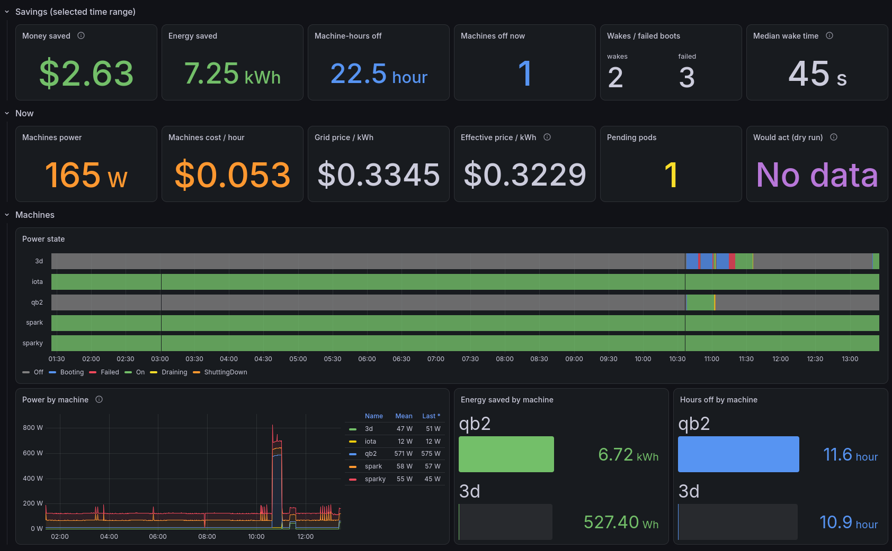

# nodenap

Power your homelab's machines on and off automatically, so your Kubernetes
cluster uses (and pays for) only the hardware it needs right now.

Homelabs are usually a mix: a few mini PCs, a GPU workstation, an old server,
some Raspberry Pis. They draw very different amounts of power and can run
different workloads. nodenap:

- **wakes the cheapest machine that can run a pending pod**: it remembers each
  powered-off machine's capabilities (CPU, memory, GPUs, architecture, labels,
  taints), so a GPU job wakes a GPU box and a small pod wakes a mini PC;
- **powers off idle machines**, least efficient first, once their pods fit
  elsewhere;
- **knows what power costs right now**: time-of-use tariffs, live prices
  (e.g. from Home Assistant), solar surplus and home batteries;
- **switches machines however they can be switched**: Wake-on-LAN, smart
  plugs (Shelly, Tasmota, anything in Home Assistant), IPMI, Redfish, the
  Talos API, Sidero Omni, or SSH.

Powered-off machines **stay in the cluster** as Nodes. Nothing is deleted.

```
             every 15s (one leader)
 Nodes  ┐   ┌──────────────────────────────────────────────────────────┐
 Pods   ├──►│ measure → price → plan → step each Machine's state       │──► PowerPolicy status,
 Prices ┘   │ (plugs,    (tariff,  (wake    machine: drain → shutdown   │    Events, metrics
            │  BMCs,      solar,    / off)  → power cut … wake → Ready) │
            │  PromQL)    battery)                                     │
            └──────────────────────────────────────────────────────────┘
```

The Helm chart includes a Grafana dashboard that shows what's on, what it
costs right now and what nodenap has saved
([details](docs/savings-and-telemetry.md#grafana-dashboard)):



### Public savings total

**<https://rothgar.github.io/nodenap/savings/>** shows the total energy
saved by every nodenap install that has opted in. To add yours, turn on the
anonymous daily report (one small JSON payload, logged before it's sent; no
names, addresses or prices; [details](docs/savings-and-telemetry.md#anonymous-telemetry-opt-in)):

```yaml
spec:
  telemetry:
    enabled: true
    endpoint: https://nodenap-collector.123dev.workers.dev/report
```

Raw totals: [`/stats`](https://nodenap-collector.123dev.workers.dev/stats).

## Try it (dry run: changes nothing)

```sh
kubectl create namespace nodenap
kubectl label namespace nodenap pod-security.kubernetes.io/enforce=privileged
helm install nodenap oci://ghcr.io/rothgar/charts/nodenap -n nodenap
```

The label lets the controller use `hostNetwork` (for Wake-on-LAN broadcasts)
on clusters that enforce Pod Security, such as Talos. Without it the
Deployment never gets a pod. Don't use Wake-on-LAN? Skip the label and add
`--set hostNetwork=false --create-namespace`.

That's all it takes to see what nodenap would do. It starts in **dry run**
with a default PowerPolicy: it watches your cluster and, after about 15
minutes, lists which nodes could sleep. No setup is needed:

```sh
kubectl get powerpolicy default -o jsonpath='{range .status.suggestions[*]}{.target}{"\t"}{.machine}{"\t"}{.reason}{"\n"}{end}'
```

```
Off   pi-2     unneeded for 15m0s at 10% utilization; saves 15W (0.0030/h) (no Machine yet: watts estimated from node size)
Off   nuc-3    unneeded for 15m0s at 4% utilization; saves 29W (0.0058/h) (no Machine yet: watts estimated from node size)
```

Dry run never touches a Node, pod or machine. To let nodenap act:

1. set your price (`kubectl edit powerpolicy default`; see
   [finding your power costs](docs/power-costs.md));
2. add a `Machine` for each machine that may sleep, saying how to wake it and
   shut it down ([power drivers](docs/power-drivers.md),
   [examples](docs/examples/));
3. when its decisions look right, set `dryRun: false`.

There's also a what-if tool that needs nothing installed. `powerplan` reads
your live cluster, runs the real decision loop on an in-memory copy, and
prints what would happen:

```sh
go run github.com/rothgar/nodenap/cmd/powerplan@latest -f my-config.yaml
```

## Documentation

Read it on the web at **<https://rothgar.github.io/nodenap/>**, or here:

| | |
|---|---|
| [Getting started](docs/getting-started.md) | Install, Secrets, first Machine, dry run, going live |
| [How it works](docs/how-it-works.md) | Decisions, safety rules, metrics, troubleshooting |
| [Configuration reference](docs/configuration.md) | Every PowerPolicy and Machine field |
| [Power drivers](docs/power-drivers.md) | Turning machines on and off: WoL, Shelly, Tasmota, Home Assistant, IPMI, Redfish, Talos, Omni, SSH |
| [Power sensors](docs/power-sensors.md) | Measuring watts: plugs, BMCs, Prometheus, Kepler, Home Assistant |
| [Finding your power costs](docs/power-costs.md) | Reading your bill, time-of-use and dynamic prices, checking your numbers |
| [Solar and batteries](docs/solar-and-batteries.md) | Net metering, export prices, battery handling |
| [Savings and telemetry](docs/savings-and-telemetry.md) | What it has saved you, and the opt-in anonymous report |
| [Examples](docs/examples/) | Complete configs for common setups |

## Development

```sh
make test       # unit and loop tests, no cluster needed
make generate   # deepcopy
make manifests  # CRDs and RBAC (also copied into the Helm chart)
make build      # bin/nodenap
```

Layout: `api/v1alpha1` (CRDs), `internal/scaler` (the loop and per-machine
state machine), `internal/planner` (decision logic and scheduling simulation),
`internal/energy` (prices, solar, battery), `internal/drivers` (power
on/off/measure), `internal/sources` (Prometheus, Home Assistant and HTTP
readings), `cmd/nodenap`, `cmd/powerplan`.

## License

Apache License 2.0, see [LICENSE](LICENSE).
