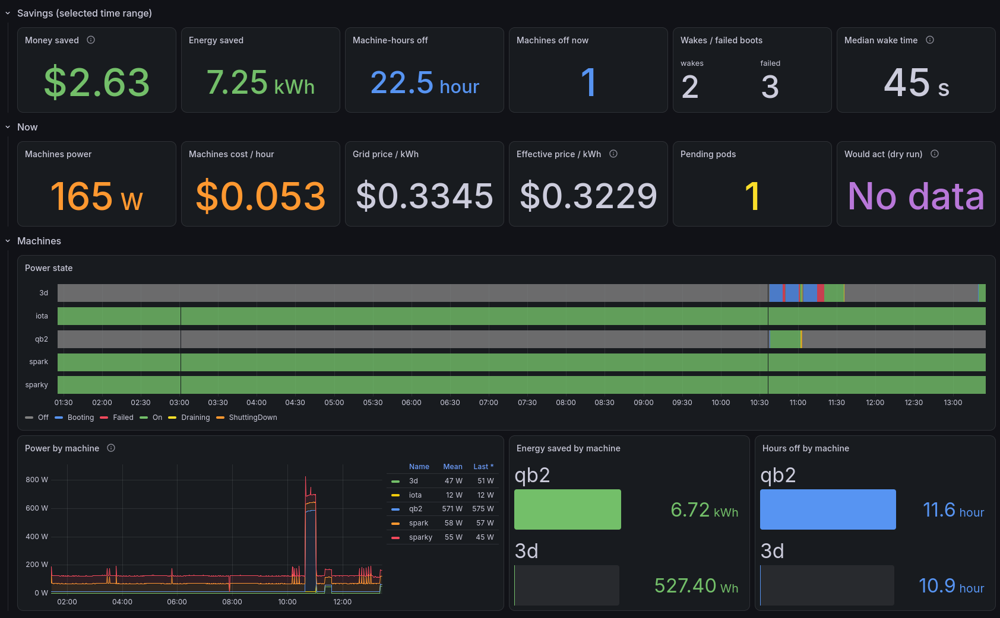

<div class="nn-hero" markdown>

# node<span>nap</span>

<p class="nn-lede">A Kubernetes controller that powers your homelab's machines on and off,
so your cluster uses (and pays for) only the hardware it needs right now.</p>

[Get started](getting-started.md){ .md-button .md-button--primary }
[How it works](how-it-works.md){ .md-button }
[GitHub](https://github.com/rothgar/nodenap){ .md-button }

</div>

<div class="nn-tiles">
  <div class="nn-tile"><div class="nn-label">Energy saved</div><div class="nn-value" data-stat="energy">–</div></div>
  <div class="nn-tile"><div class="nn-label">Machine-hours off</div><div class="nn-value" data-stat="hours">–</div></div>
  <div class="nn-tile"><div class="nn-label">Installs</div><div class="nn-value" data-stat="installs">–</div></div>
  <div class="nn-tile"><div class="nn-label">Median wake</div><div class="nn-value" data-stat="wake">–</div></div>
</div>
<p class="nn-status"><a href="savings/">More on the public totals</a></p>

## What it does

Homelabs are usually a mix: a few mini PCs, a GPU workstation, an old
server, some Raspberry Pis. They draw very different amounts of power and run
different workloads.

<div class="grid cards nn-features" markdown>

-   :material-lightning-bolt:{ .lg } **Wakes the cheapest machine that fits**

    ---

    It remembers each powered-off machine's CPU, memory, GPUs, architecture,
    labels and taints, so a GPU job wakes a GPU box and a small pod wakes a
    mini PC.

-   :material-power-sleep:{ .lg } **Powers off idle machines**

    ---

    Least efficient first, once their pods fit elsewhere. Drains respect
    PodDisruptionBudgets, and powered-off machines stay in the cluster as
    Nodes.

-   :material-currency-usd:{ .lg } **Knows what power costs right now**

    ---

    Time-of-use tariffs, live prices (for example from Home Assistant),
    solar surplus and home batteries.

-   :material-power-plug:{ .lg } **Switches machines however they can be switched**

    ---

    Wake-on-LAN, smart plugs (Shelly, Tasmota, Home Assistant), IPMI,
    Redfish, the Talos API, Sidero Omni, or SSH.

</div>

## How it works

```
             every 15s (one leader)
 Nodes  ┐   ┌──────────────────────────────────────────────────────────┐
 Pods   ├──►│ measure → price → plan → step each Machine's state       │──► PowerPolicy status,
 Prices ┘   │ (plugs,    (tariff,  (wake    machine: drain → shutdown   │    Events, metrics
            │  BMCs,      solar,    / off)  → power cut … wake → Ready) │
            │  PromQL)    battery)                                     │
            └──────────────────────────────────────────────────────────┘
```

The Helm chart includes a Grafana dashboard that shows what's on, what it
costs right now and what nodenap has saved:



## Try it in dry run

Dry run never touches a Node, pod or machine. After about 15 minutes it
lists which nodes could sleep.

```sh
kubectl create namespace nodenap
kubectl label namespace nodenap pod-security.kubernetes.io/enforce=privileged
helm install nodenap oci://ghcr.io/rothgar/charts/nodenap -n nodenap
kubectl get powerpolicy default -o jsonpath='{range .status.suggestions[*]}{.target}{"\t"}{.machine}{"\t"}{.reason}{"\n"}{end}'
```

Then [set your price](power-costs.md), add a `Machine` for each machine that
may sleep ([power drivers](power-drivers.md)), and set `dryRun: false`.
[Getting started](getting-started.md) walks through it.
